# Foodiary

<p align="center">
  <picture>
    <source media="(prefers-color-scheme: dark)" srcset="docs/images/logo-light.svg">
    
  </picture>
</p>

<p align="center"><b>Registre suas refeições e acompanhe sua dieta sem complicação.</b></p>

<p align="center">
  
  
  
  
  
  
</p>

O Foodiary é um aplicativo de controle alimentar para celular. Você registra cada refeição tirando uma foto do prato, gravando um áudio ou digitando os alimentos, e o app mostra quanto já consumiu de calorias, proteínas, carboidratos e gorduras no dia, em comparação com metas calculadas a partir do seu perfil. Ele também acompanha a evolução do peso, ajuda a planejar a próxima refeição e mostra a sua constância ao longo das semanas. O repositório reúne o app, feito com Expo e React Native, e a API em Node.js, com PostgreSQL para os dados e Garage para as fotos e os áudios.

<p align="center">
  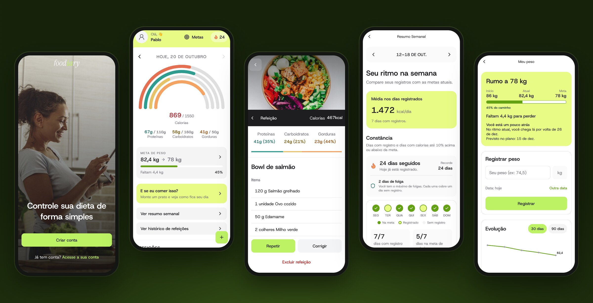
</p>

## Funcionalidades

### Conta e metas

- Cadastro em etapas: objetivo, sexo, data de nascimento, altura, peso, peso desejado e nível de atividade.
- Metas diárias de calorias e macronutrientes calculadas a partir do perfil (equação de Harris-Benedict revisada e fator de atividade), com opção de ajuste manual.
- Login com token de acesso de 15 minutos e refresh token renovado a cada uso. No celular, a sessão fica guardada no SecureStore.
- Recuperação de senha por código de seis dígitos e foto de perfil com recorte.

### Registro de refeições

- **Foto:** a imagem do prato é enviada ao armazenamento e analisada pela API, que identifica os alimentos e estima as porções e os nutrientes.
- **Áudio:** você descreve a refeição falando; o áudio é transcrito e analisado da mesma forma.
- **Manual:** você digita os alimentos ou escolhe entre os que já salvou, sem depender de serviço externo.
- **Rótulo nutricional:** uma foto da tabela nutricional vira um alimento salvo, pronto para reutilizar.
- Toda refeição pode ser corrigida, repetida em outro momento ou excluída, e também é possível registrar refeições de dias anteriores.

### Acompanhamento

- Tela inicial com o consumo do dia em relação às metas, com navegação entre os dias.
- **E se eu comer isso?**: monte um prato com alimentos salvos, ajuste as porções e veja como o dia ficaria antes de registrar.
- Resumo semanal com a média dos dias registrados e a comparação com as metas.
- Histórico completo das refeições, das mais recentes às mais antigas, carregado em páginas.

### Peso

- Registro de peso com gráfico de evolução dos últimos 30 ou 90 dias.
- Meta de peso com três ritmos (tranquilo, moderado ou acelerado), previsão da data de chegada e indicação se você está adiantado ou atrasado em relação ao plano.
- Quando o peso muda, o app sugere novas metas diárias, e você decide se quer aplicá-las.

### Constância e conquistas

- Sequência de dias seguidos com refeições registradas e recorde pessoal.
- A cada 7 dias de sequência você ganha um dia de folga (até 2), que cobre um dia sem registro sem zerar a contagem.
- 13 conquistas ligadas à constância, à meta de peso e às formas de registrar.
- Lembrete diário opcional, entre 19h e 22h, que não aparece nos dias em que você já registrou alguma refeição.

<table>
  <tr>
    <td align="center">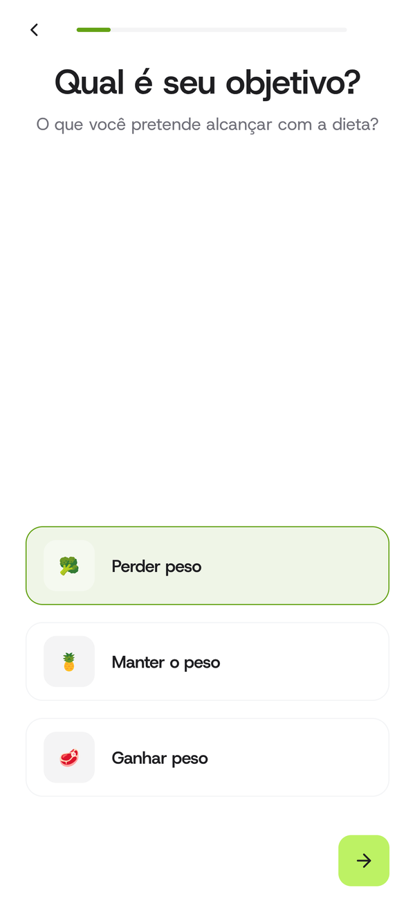<br><sub>Cadastro em etapas</sub></td>
    <td align="center">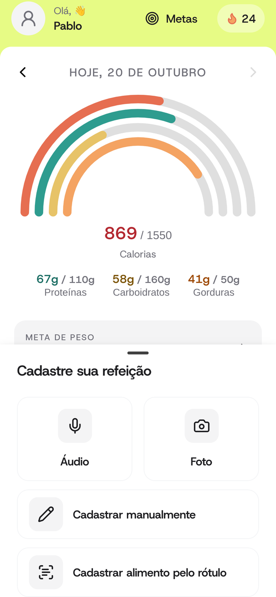<br><sub>Formas de registrar</sub></td>
    <td align="center">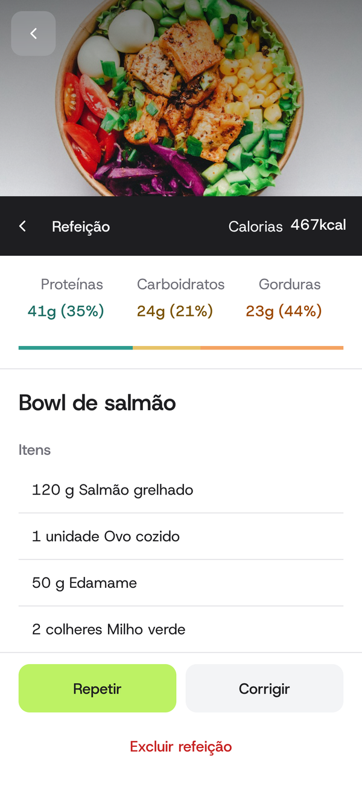<br><sub>Detalhes da refeição</sub></td>
    <td align="center">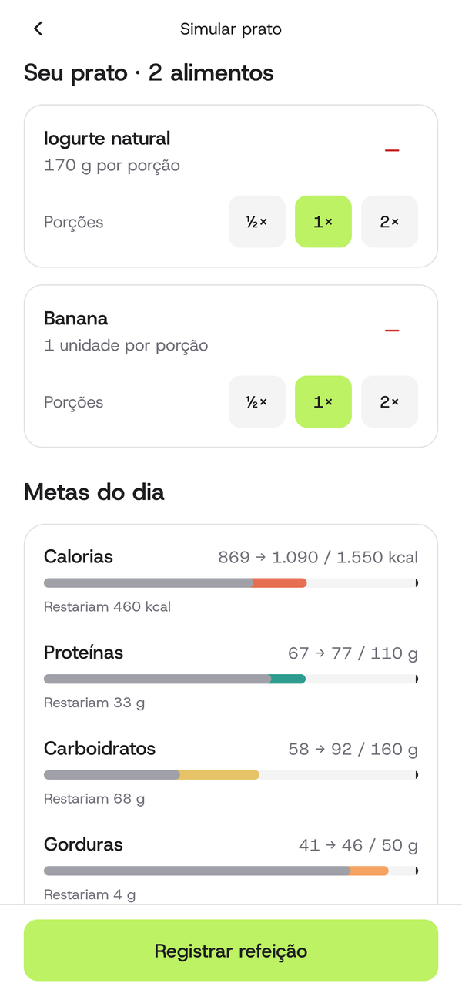<br><sub>E se eu comer isso?</sub></td>
  </tr>
  <tr>
    <td align="center">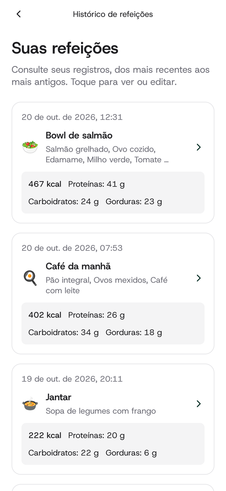<br><sub>Histórico de refeições</sub></td>
    <td align="center">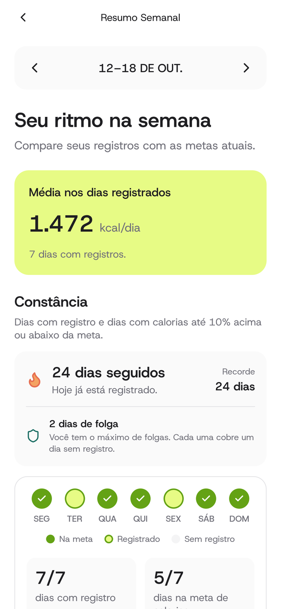<br><sub>Resumo semanal</sub></td>
    <td align="center">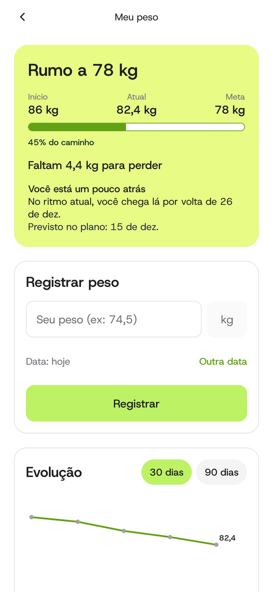<br><sub>Meu peso</sub></td>
    <td align="center">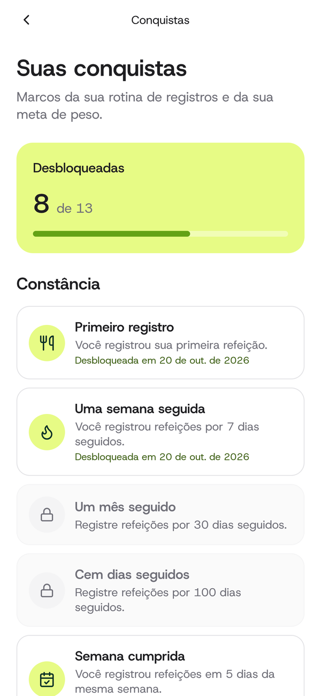<br><sub>Conquistas</sub></td>
  </tr>
</table>

## Tecnologias

| Parte | Principais ferramentas |
| --- | --- |
| **App** | Expo SDK 57, React Native 0.86, React 19, TypeScript, React Navigation, TanStack Query, React Hook Form, Zod, Reanimated e Moti, Bottom Sheet, Expo Camera, Expo Audio, Expo Notifications, Expo SecureStore, Lucide |
| **API** | Node.js, TypeScript, servidor HTTP nativo do Node, `pg`, Zod, `jose` (JWT), `scrypt` para senhas, SDK da AWS para S3, Busboy, SDK da OpenAI, injeção de dependências com decorators |
| **Banco e infraestrutura** | PostgreSQL 16 e Garage (armazenamento compatível com S3) em Docker Compose, migrações em SQL puro, upload direto por POST pré-assinado e leitura por URLs assinadas e temporárias |
| **Serviços externos** | API da OpenAI: `gpt-4.1-mini` para fotos, texto e rótulos e `gpt-4o-mini-transcribe` para áudios |
| **Ferramentas** | pnpm, ESLint, `tsx` e scripts de verificação com banco real |

A API não usa framework web: as rotas, a autenticação e o tratamento de erros ficam em `src/main/http/server.ts`, e o código segue camadas simples (controllers, casos de uso, entidades, repositórios e gateways).

## Fluxograma

<p align="center">
  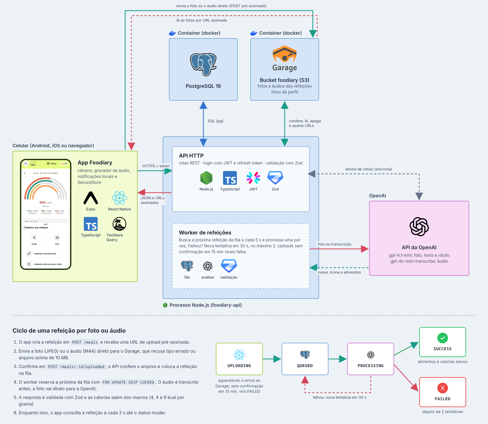
</p>

O app conversa com a API para quase tudo. A exceção são os arquivos: a foto ou o áudio de uma refeição vão direto para o Garage, por uma URL de upload pré-assinada, e o app só avisa a API quando o envio termina. A API confere o arquivo e coloca a refeição numa fila no PostgreSQL, que o worker processa uma por vez enquanto o app acompanha o status. Na leitura de rótulo, a foto passa pela própria API, que chama a OpenAI e responde na mesma requisição.

## Modelagem de dados

<p align="center">
  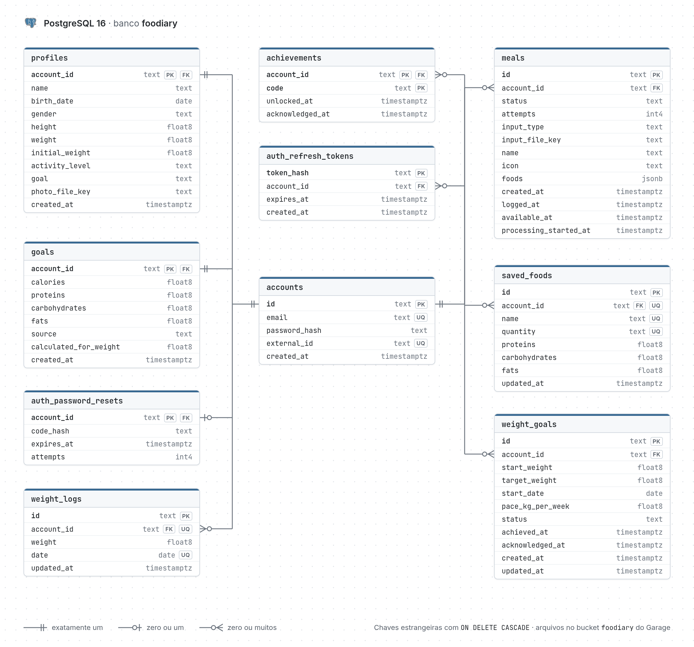
</p>

Tudo gira em torno de `accounts`. Perfil, metas diárias e recuperação de senha têm no máximo uma linha por conta; as outras tabelas guardam o histórico, e só uma meta de peso pode estar ativa por vez. Os alimentos de cada refeição ficam em uma coluna `jsonb`, já que sempre são lidos e gravados junto com a refeição. A coluna `created_at` de `meals` indica o dia a que a refeição pertence, e `logged_at` registra quando ela foi cadastrada, o que permite calcular a sequência de dias de forma justa. O banco guarda só a chave de cada arquivo (`input_file_key` e `photo_file_key`); o arquivo em si fica no bucket do Garage. As migrações ficam em [`foodiary-api/db`](foodiary-api/db), numeradas na ordem em que devem ser aplicadas.

## Estrutura do projeto

```
foodiary/
├── compose.yaml          # PostgreSQL e Garage locais
├── garage.toml           # configuração do Garage
├── foodiary-api/
│   ├── db/               # migrações SQL (001 a 011)
│   ├── scripts/          # verificações de integração e migração de arquivos
│   └── src/
│       ├── application/  # entidades, casos de uso, controllers, regras de metas e sequência
│       ├── infra/        # repositórios PostgreSQL, OpenAI, autenticação e armazenamento S3
│       ├── kernel/       # injeção de dependências
│       └── main/http/    # servidor HTTP e worker de refeições
└── foodiaryapp/
    └── src/
        ├── app/          # serviços HTTP, hooks de consulta, contexto de autenticação e navegação
        └── ui/           # telas, componentes e tema
```

## Como rodar localmente

### Pré-requisitos

- Node.js 22 ou mais recente
- pnpm 10
- Docker com Docker Compose
- Expo Go compatível com o SDK 57 no celular, ou um emulador Android ou simulador iOS
- Uma chave da API da OpenAI, apenas se quiser registrar refeições por foto, áudio ou rótulo

### 1. Banco de dados e armazenamento

Na raiz do repositório:

```bash
docker compose up -d postgres garage
```

O PostgreSQL fica em `127.0.0.1:5434`, com banco e usuário `foodiary` e senha `foodiary_dev`. As migrações de `foodiary-api/db` são aplicadas na primeira vez que o volume é criado. Se você já tinha um volume de uma versão anterior, aplique apenas os arquivos novos, seguindo o [guia do banco](foodiary-api/db/README.md).

O Garage fica na porta `3900`, já com o bucket `foodiary` e uma chave de acesso de desenvolvimento definidos no `compose.yaml`. Ele roda com um único nó, sem cópia redundante dos dados, o que basta para uso local.

### 2. API

```bash
cd foodiary-api
pnpm install --frozen-lockfile
cp .env.example .env
```

No `.env`, preencha:

- `AUTH_JWT_SECRET`: um segredo com pelo menos 32 bytes. Você pode gerar um com `openssl rand -base64 48`.
- `S3_PUBLIC_ENDPOINT`: o endereço pelo qual o celular alcança o Garage, que recebe os uploads direto do app. Siga a mesma regra do `EXPO_PUBLIC_API_URL` do app (tabela abaixo), trocando a porta para `3900`. As outras variáveis `S3_*` já vêm prontas no `.env.example`.
- `OPENAI_API_KEY`: opcional. Sem ela, todo o resto funciona normalmente, mas as refeições por foto ou áudio ficam na fila até a chave ser configurada e a leitura de rótulo não funciona. O uso da API da OpenAI é cobrado pela própria OpenAI.

Se você usava uma versão anterior, que guardava os arquivos em `foodiary-api/data`, rode `pnpm migrate:files` uma vez para copiá-los para o Garage. O script não apaga nada do disco.

Depois, inicie o servidor:

```bash
pnpm dev
```

A API escuta na porta `3005` em todas as interfaces de rede, para que o celular consiga acessá-la. Para conferir se ela está no ar, abra `http://127.0.0.1:3005/health`. Em desenvolvimento, o código de recuperação de senha aparece no terminal da API.

### 3. App

Em outro terminal:

```bash
cd foodiaryapp
pnpm install --frozen-lockfile
cp .env.example .env
```

Ajuste `EXPO_PUBLIC_API_URL` no `.env` conforme o lugar em que o app vai rodar. Use o mesmo endereço, com a porta `3900`, no `S3_PUBLIC_ENDPOINT` da API:

| Onde o app roda | Valor |
| --- | --- |
| Emulador Android | `http://10.0.2.2:3005` |
| Simulador iOS ou navegador no mesmo computador | `http://127.0.0.1:3005` |
| Celular físico na mesma rede | `http://IP_DO_COMPUTADOR:3005` |

Então inicie o Expo e leia o QR code com o Expo Go:

```bash
pnpm dev
```

Se o computador tiver mais de uma interface de rede e o QR code mostrar o IP errado, use `REACT_NATIVE_PACKAGER_HOSTNAME=IP_DO_COMPUTADOR pnpm dev`.

### Versão web

Para ver a interface no navegador, libere a origem do Expo Web na API e inicie o app com `pnpm web`. Ao iniciar, a API aplica essas mesmas origens ao CORS do bucket, para o navegador conseguir enviar arquivos ao Garage:

```bash
# em foodiary-api
ALLOWED_WEB_ORIGINS=http://localhost:19006,http://127.0.0.1:19006 pnpm start:local

# em foodiaryapp
EXPO_PUBLIC_API_URL=http://127.0.0.1:3005 pnpm web
```

O app abre em `http://localhost:19006`. Câmera, gravação de áudio e lembrete diário dependem de recursos nativos e devem ser testados no celular.

### Verificações

Cada projeto tem um comando que roda checagem de tipos, lint e testes. Os testes da API precisam do PostgreSQL e do Garage ativos:

```bash
# em foodiary-api
pnpm verify

# em foodiaryapp
pnpm verify
```

Os testes da API criam registros temporários no banco e os removem ao final. O teste da fila usa uma resposta simulada e não consome créditos da OpenAI.

Os READMEs de [`foodiary-api`](foodiary-api/README.md) e [`foodiaryapp`](foodiaryapp/README.md) trazem mais detalhes, como a lista completa de rotas e o comportamento de cada tela.
